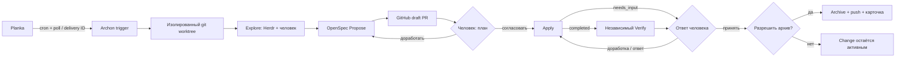

# Archon Development Pipeline

Демонстрация управляемого агентного процесса разработки: от карточки задачи до согласованной реализации и обновлённого draft PR. Archon координирует работу, OpenSpec хранит контракт изменения, отдельный агент проверяет реализацию, а решения о плане, приёмке и архивации остаются за человеком.

**[Открыть интерактивную карту](docs/pipeline.html)** · [Архитектура и ограничения](#архитектура-и-поведение) · [Адаптация и запуск](docs/setup.md) · [Примеры](examples/)

Это очищенный срез реально описанной реализации, предназначенный для технического ревью, а не готовый к развёртыванию продукт. Идентификаторы, учётные данные и предметная область исходного проекта исключены. Снимок workflow показывает структуру и контракты, а команды и скрипты очищены и требуют настройки; комплект не исполняется как есть. Никаких утверждений об успешных production-прогонах здесь нет.

## Путь задачи

1. **Planka → Archon.** Планировщик вызывает stateless poller. Он формирует стабильный delivery ID для версии карточки; дедупликация и очередь ограниченного ресурса находятся в Archon. Для задачи создаётся git worktree.
2. **Explore → Propose.** При необходимости человек обсуждает задачу с агентом через Herdr. Итоги передаются в Propose, который создаёт артефакты OpenSpec. Публикация создаёт draft PR.
3. **Ревью плана.** Человек рассматривает PR и отвечает на ожидание Archon. Reject запускает доработку и повторную публикацию; approve передаёт план в реализацию.
4. **Apply → Verify → человек.** Apply выполняет задачи и возвращает `completed` или `needs_input`. После `completed` отдельный Verify проверяет результат и пишет `review.md`; публикация предшествует приёмке. При блокере Verify пропускается, а ответ человека возвращает управление Apply. Замечания и исключения обсуждаются в PR, но сам комментарий не возобновляет процесс — требуется ответ в Archon.
5. **Архивация.** После приёмки отдельный approval разрешает синхронизацию спецификаций и архивирование OpenSpec change. Затем обновляются PR и карточка. Отклонение оставляет change активным.

## Архитектура и поведение

<!-- architecture-start -->

### До оркестрации: человек запускает каждую стадию

```mermaid
flowchart LR
 T[Человек: задача в трекере] --> B[Человек: создать Git-ветку]
 B --> E[Отдельный чат: Explore]
 E -->|Человек запускает следующую стадию| P[Отдельный чат: Propose]
 P -->|Человек запускает следующую стадию| A[Отдельный чат: Implement]
 A -->|Человек запускает проверку| V[Отдельный чат: Verify]
 V -->|Человек запускает доработку| A
 V -->|Человек запускает архивацию| R[Отдельный чат: Archive]
 R --> C[Человек: закрыть задачу]
 C --> D[Deploy по процессу проекта]
```

Каждая SDD-стадия выполнялась в отдельном чате. OpenSpec-артефакты передавали согласованные решения и результаты между чатами; человек отвечал за завершение текущей стадии и запуск следующей.

### С Archon: движок ведёт процесс между решениями человека

### Что изменилось

| Действие | Раньше | С Archon |
| --- | --- | --- |
| Запуск и переходы между стадиями | Человек создаёт ветку, открывает отдельный чат и вручную запускает каждую следующую стадию. | После выбора карточки запуск и переходы координирует Archon; триггер, ожидания и условия переходов описаны в workflow. |
| Передача контекста | Человек запускает новый чат, агент читает артефакты OpenSpec предыдущей стадии. | Те же артефакты остаются контрактом между стадиями; workflow передаёт результаты и маршрутизирует управление. |
| Доработка | Человек вручную инициирует новую сессию для исправлений и повторной проверки. | Archon повторяет циклы плана и реализации после решения человека; PR-комментарий сам по себе запуск не возобновляет. |
| Решения человека | Человек обсуждает задачу, проверяет результат и решает, когда переходить дальше. | Explore остаётся интерактивным; согласование плана, приёмка и отдельное разрешение архивации остаются за человеком. |
| Рабочее окружение | Работа организована вокруг вручную созданной Git-ветки и локальных агентов. | Для запуска используется изолированный Git worktree со своей веткой; окружение разработки контейнеризовано. Общий Docker-стек пока не изолирован по запускам, поэтому доступ к нему сериализуется. |
| Завершение и deploy | Человек закрывает задачу и выполняет deploy по процессу проекта. | После разрешённой архивации workflow обновляет PR и карточку; merge и deploy описанный workflow не выполняет. |

Переход от ветки к worktree меняет организацию рабочих копий: ветка Git остаётся, но каждый запуск работает в отдельном каталоге. Worktree не изолирует контейнеры, порты, базы или общие сервисы; полноценная параллельная контейнерная изоляция — дальнейший эксперимент.
<!-- architecture-end -->

## Что показывают файлы

- [Интерактивная карта](docs/pipeline.html) — автономный HTML с маршрутами, переходами и артефактами; откройте файл в браузере, сеть не нужна.
- [Инструкция](docs/setup.md) — как безопасно исследовать и адаптировать пример.
- [Снимок workflow](examples/workflow.yaml) — очищенный YAML с реальной топологией и заглушками имён моделей; команды и скрипты включены как адаптируемые примеры.
- [Скрипты](examples/scripts/) и [промпты](examples/commands/) — очищенные адаптации исходных стадий; [poller](examples/poll.py) и [конфигурация](examples/config.yaml) — примеры без данных окружения.
