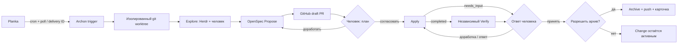

# Архитектура и поведение

[← README](../README.md) · [Интерактивная карта](pipeline.html) · [Запуск и адаптация](setup.md)

## Ответственность компонентов

| Компонент | Роль |
| --- | --- |
| Planka | Источник задачи и видимость стадии; итоговый статус обновляется после успешной архивации и push. |
| Cron и poller | Находят подходящие карточки и доставляют события; poller не хранит состояние. |
| Archon | Дедупликация доставки, admission/очередь общего ресурса, worktree, выполнение графа и устойчивые ожидания человека. Worktree изолирует файлы Git, но не сервисы, окружение или общую базу Archon. |
| Herdr | Интерактивная сессия Explore с человеком; её результат сохраняется в файл, затем событие продолжает ожидающий run. Пропуск Explore разрешён признаком карточки. |
| OpenSpec | Proposal, delta specs, design и tasks задают план; review.md сохраняет результаты Verify; Archive синхронизирует спецификации. |
| GitHub PR | Единое место ревью плана, кода и отчёта. Остаётся draft; описанный процесс не выполняет merge. |
| Apply | Реализует оставшиеся задачи и обрабатывает замечания, в том числе когда tasks уже отмечены; при блокере возвращает `needs_input`. |
| Verify | Отдельный агент со свежим контекстом проверяет полноту, корректность и согласованность; возвращает `ready` или `needs_work` и пишет отчёт. |
| Человек | Обсуждает Explore, согласует или отклоняет план, отвечает на вопросы и принимает реализацию, отдельно разрешает архивирование. |

## Циклы и границы отказов

Публикация proposal происходит до вопроса человеку. Повторная публикация использует тот же PR и не создаёт пустой коммит. При reject агент читает актуальные обсуждения, дорабатывает change и снова публикует его. После сбоя группа начинает с первой итерации: повторная публикация помогает доставить готовый коммит, но checkpoint контекста итерации не реализован.

В цикле реализации `completed` запускает независимый Verify; `needs_input` пропускает Verify, публикует готовые коммиты и передаёт вопрос человеку. Неоконченные локальные правки сохраняются. После публикации вопрос даёт продолжить Apply или принять результат в зависимости от состояния. `needs_work` сам по себе не запрещает приёмку: человек может явно принять исключение в треде на строке review.md. Последующие Apply, Verify и Archive учитывают этот контекст. Автоматический merge здесь не предусмотрен.

Агенты читают общие комментарии, reviews и inline-треды PR с пагинацией. Комментарий сам по себе не возобновляет run: человек отвечает на соответствующий wait в Archon. Ошибка публикации блокирует соответствующую приёмку; ошибка финального push блокирует обновление карточки. Explore имеет ограниченный срок ожидания; пустой результат или истечение срока блокирует Propose.

## Что реализовано и что требует работы

Описанная топология, два цикла, event для Explore, отдельная архивация и обработка feedback присутствуют в исходных файлах. Схема показывает предназначенное поведение, а не подтверждение каждого маршрута работающим production-стендом. Локальные dry-run фикстуры исходного проекта не являются доказательством работы внешних интеграций.

Для повторного использования необходимо адаптировать включённые интеграционные команды и скрипты, настроить привязку trigger, авторизацию, навыки OpenSpec, среду Herdr и систему блокировки общих ресурсов, а также проверить версии CLI и права. Схема имён worktree и удобная ссылка на удалённые артефакты остаются проектными решениями; восстановление контекста итерации после сбоя не реализовано. Модель и её параметры зависят от окружения и здесь не зафиксированы.
