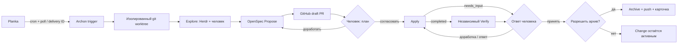

# Демо: оркестратор агентов для процесса разработки ПО.

Процесс разработки изначально построен с использованием методологии SDD ([OpenSpec](https://openspec.dev/)). В качестве оркестратора используется [Archon](https://archon.diy/), описывающий процессы как DAG (Directed Acyclic Graph, направленный ациклический граф) в формате YAML. Верхнеуровневый граф ацикличен, но отдельные его узлы могут содержать циклы.

## Стадии развития процесса

### ДО: Локальные агенты и ручные переходы

Разработка уже велась с локальными агентами и практиками OpenSpec. 

- Человек заводил задачу в трекере, 
- создавал git ветку
- самостоятельно запускал стадии: `Explore` → `Propose` → `Implement` ↔ `Verify` → `Archive`.

Каждая стадия проходила в отдельном чате. После неё человек оценивал результат и инициировал следующую; затем закрывал задачу и выполнял deploy по принятому процессу проекта.

OpenSpec создавал артефакты между стадиями: выход предыдущей стадии становился входом следующей. Так сохранялся контекст требований и решений между отдельными чатами. Человек отвечал за завершение текущей стадии и запуск следующей.

```mermaid
flowchart LR
 T[Человек: задача в трекере] --> B[Человек: создать Git-ветку]
 B --> E[Отдельный чат: Explore]
 E -->|Человек запускает следующую стадию| P[Отдельный чат: Propose]
 P -->|Человек запускает следующую стадию| A[Отдельный чат: Implement]
 A -->|Человек запускает проверку| V[Отдельный чат: Verify]
 V -->|Человек запускает доработку| A
 V -->|Человек запускает архивацию| R[Отдельный чат: Archive]
 R --> C[Человек: закрыть задачу]
 C --> D[Deploy по процессу проекта]
```

### Удалённая среда и Herdr

Агенты переехали с локальной машины на VPS. Стал использоваться агентный мультиплексор Herdr: он помогает:

- создавать изолированные git worktree,
- запускать удалённые сессии агентов - для каждой стадии SDD и переключаться между ними. 

Сама удаленная среда позволяет не держать постоянно включенный локальный компьютер. Структура процесса при этом сохранилась.

### ПОСЛЕ: Движок Archon ведёт процесс между решениями человека

Следующий шаг — эксперимент с готовым DAG-оркестратором Archon, вдохновлённый первым хакер-спринтом Podlodka AI [«Фабрика фичей»](https://podlodka.ai/hacker-sprints/features-factory/). Archon автоматизирует переходы между стадиями, передачу артефактов и постановку ожиданий человека, уменьшая число ручных действий. Сами стадии OpenSpec и их назначение остаются практически прежними.

Максимальная интерактивность сохраняется в `Explore`: человек обсуждает и уточняет задачу с агентом через Herdr. Остальные агентные стадии специально выполняются неинтерактивно — это соответствует модели оркестрации и готовит процесс к дальнейшим экспериментам. Человек по-прежнему согласует план, принимает реализацию и отдельно разрешает архивацию; вопросы и замечания передаются через PR и диалоги ввода Archon.

### Что изменилось

| Действие | Раньше | С Archon |
| --- | --- | --- |
| Запуск и переходы между стадиями | Человек создаёт ветку, открывает отдельный чат и вручную запускает каждую следующую стадию. | После выбора карточки запуск и переходы координирует Archon; триггер, ожидания и условия переходов описаны в workflow. |
| Передача контекста | Человек запускает новый чат, агент читает артефакты OpenSpec предыдущей стадии. | Те же артефакты остаются контрактом между стадиями; workflow передаёт результаты и маршрутизирует управление. |
| Доработка | Человек вручную инициирует новую сессию для исправлений и повторной проверки. | Archon повторяет циклы плана и реализации после решения человека; PR-комментарий сам по себе запуск не возобновляет. |
| Решения человека | Человек обсуждает задачу, проверяет результат и решает, когда переходить дальше. | Explore остаётся интерактивным; согласование плана, приёмка и отдельное разрешение архивации остаются за человеком. |
| Рабочее окружение | Работа организована вокруг вручную созданной Git-ветки и локальных агентов. | Для запуска используется изолированный Git worktree со своей веткой; окружение разработки контейнеризовано. Общий Docker-стек пока не изолирован по запускам, поэтому доступ к нему сериализуется. |
| Завершение и deploy | Человек закрывает задачу и выполняет deploy по процессу проекта. | После разрешённой архивации workflow обновляет PR и карточку; merge и deploy описанный workflow не выполняет. |

Переход от ветки к worktree меняет организацию рабочих копий: ветка Git остаётся, но каждый запуск работает в отдельном каталоге. Worktree не изолирует контейнеры, порты, базы или общие сервисы; полноценная параллельная контейнерная изоляция — дальнейший эксперимент.

## Дальнейшие шаги

- **Изоляция среды.** Усовершенствовать контейнерное окружение, чтобы параллельные запуски тестов, e2e и экземпляров приложения не мешали друг другу. Сейчас отдельный Git worktree не изолирует общие сервисы, а общий Docker-ресурс приходится сериализовать.
- **«Хор» специализированных агентов.** Экспериментировать с дополнительными стадиями ревью SDD-артефактов и кода: агенты архитектуры, DDD и продукта сами определяют, затронута ли их зона ответственности и стоит ли подключиться. Цель — уменьшить нагрузку, в том числе когнитивную, на человека. Идея навеяна проектом [chorus](https://github.com/zaytsevand/chorus). Это план, а не реализованная возможность текущего workflow.

## Изучить процесс более подробно

[Открыть интерактивную карту →]({{ '/docs/pipeline.html' | relative_url }})

Карта показывает маршруты задачи, циклы доработки, точки участия человека и артефакты. Она работает в браузере без внешних библиотек и не запускает workflow.

- [Адаптация и запуск]({{ '/docs/setup.html' | relative_url }}) — зависимости, настройка и проверки перед использованием в своей среде.
- [Снимок workflow]({{ '/examples/workflow.yaml' | relative_url }}) и [пример poller]({{ '/examples/poll.py' | relative_url }}) — очищенные примеры для изучения.
- [Исходники и README на GitHub]({{ site.github.repository_url }}) — скрипты, промпты и документация в репозитории.